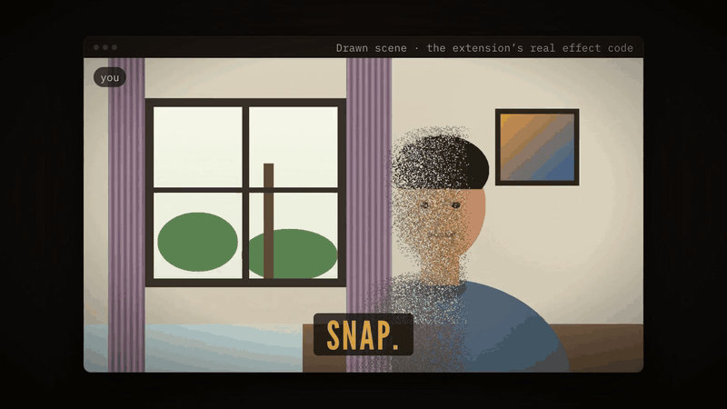

# Thanos Snap

A Chrome extension: **snap your fingers and you turn to dust on your webcam**, like the Infinity War snap. Everyone else in the call sees the empty room.

[](docs/demo/demo.mp4)

*An 11-second demo (click for the MP4). The footage is not a screen recording of a real call: it is the extension's own effect code (captured room, dust dissolve, lighting match, return) running on a drawn room and a cartoon person, and the video labels it as such. Cut with [Hyperframes](https://github.com/heygen-com/hyperframes); the footage regenerates with `node scripts/render-demo.mjs --out clip.mp4` (needs `ffmpeg`).*

It works on video calls that run in a Chrome tab (tested on Google Meet) by replacing your camera feed before the page receives it. Everything runs locally in your browser; no video or audio leaves your machine.

## How it works

1. A content script wraps `navigator.mediaDevices.getUserMedia`. For video requests it returns a processed canvas stream instead of the raw camera.
2. The person is found with MediaPipe selfie segmentation. The models run in a hidden **extension-owned iframe**, because pages like Meet enforce Trusted Types/CSP that block loading them in the page itself.
3. **Capture empty room** records your real background (averaged over ~1.5 s, with the segmenter only deciding whether you have left the frame). After the snap, that real room is shown where you were, re-lit to match the live exposure, with a soft edge. Anything that differs from the captured room and touches your mask (an arm the model missed) is hidden too.
4. Without a capture, the area behind you is filled smoothly from the surrounding pixels. An experimental **AI fill** toggle uses MI-GAN inpainting instead; it can look worse on busy backgrounds, so it is off by default.
5. The snap is detected from the microphone: a sharp, short, high-frequency transient. A second snap brings you back.

## Install (unpacked)

```sh
npm install
npm run build          # writes dist/
# optional, only for the experimental AI fill:
scripts/fetch-model.sh # downloads migan-512-generator.onnx (~28 MB) into models/, then rebuild
```

Then in Chrome: `chrome://extensions` → Developer mode → **Load unpacked** → choose the `dist/` folder. After loading or reloading the extension, **open a fresh tab** of your call: tabs that were already open keep the old version.

## Use

1. Join a call in the browser (Google Meet; Zoom's web client is untested; the Zoom desktop app is not supported because it does not use Chrome's camera).
2. Click the extension icon → **Capture empty room**, step fully out of the camera's view until the banner says *Room captured*, step back in. Don't move the camera afterwards.
3. Snap near your mic. Snap again to return.

Lower the **Snap sensitivity** slider if loud sounds in the call trigger it. The capture is not saved between page loads.

## Development

```sh
npm test               # node:test, ~90 tests, no browser needed
node scripts/strict-server.mjs 8124   # serves the repo with a Meet-like strict CSP + Trusted Types policy
```

`test-page/index.html` (served over `http://localhost`) shows the processed camera; add `#debug` to see the mask and the background memory.

Layout: `src/` is the extension (pure, tested modules plus thin browser glue), `src/host/` is the model host frame, `docs/` has the design and plan.

## Limits

- Chrome tabs only. Needs camera and microphone permission.
- A clap may trigger the snap detector (only noise, tones and speech were tested).
- Segmentation misses (hair edges, loose clothing) can leave a sliver visible; the captured-room refinement catches most of it.
- At 1280×720 the processing is tight on the frame budget; 640×480 is comfortable.

## Credits and licence

Not affiliated with Marvel or Disney; the effect is inspired by a film scene and no footage is included. Uses [MediaPipe](https://github.com/google-ai-edge/mediapipe) selfie segmentation (Apache-2.0), [ONNX Runtime Web](https://github.com/microsoft/onnxruntime) (MIT) and, optionally, [MI-GAN](https://github.com/Picsart-AI-Research/MI-GAN) (MIT, Picsart AI Research) via a third-party ONNX conversion. This repository's own code is licensed under the [Apache License 2.0](LICENSE); see [NOTICE](NOTICE).
